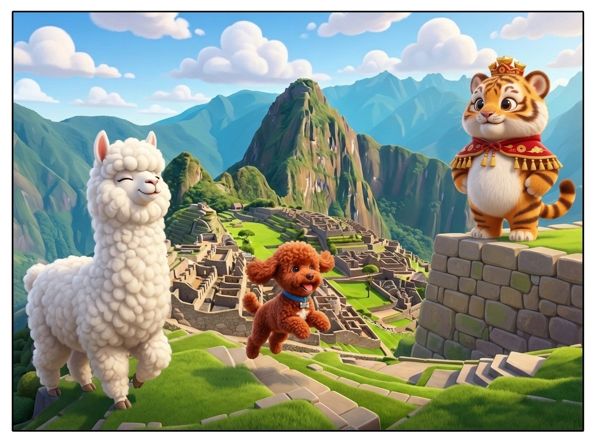
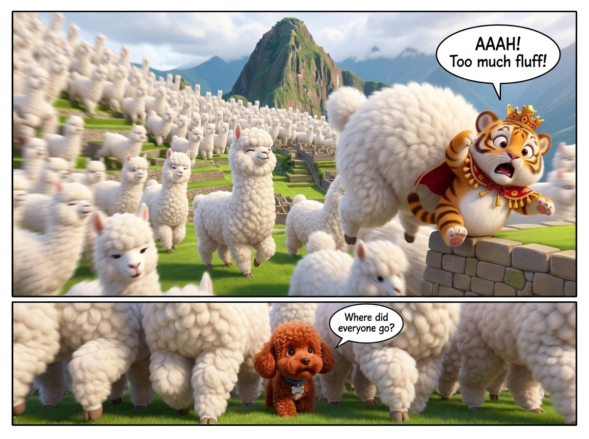
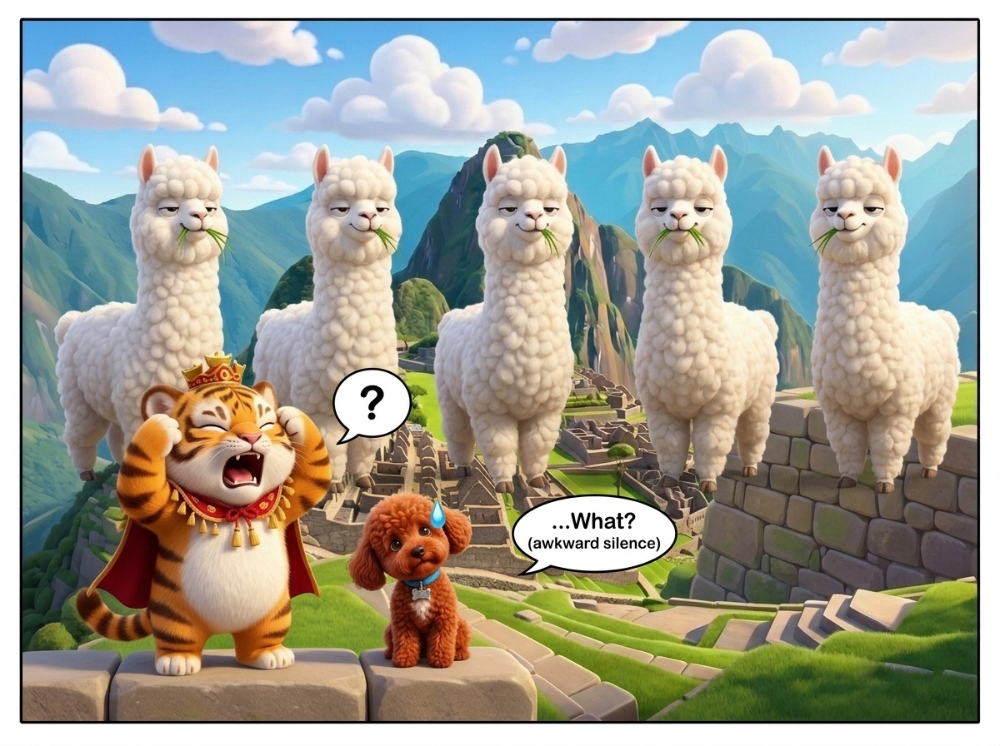
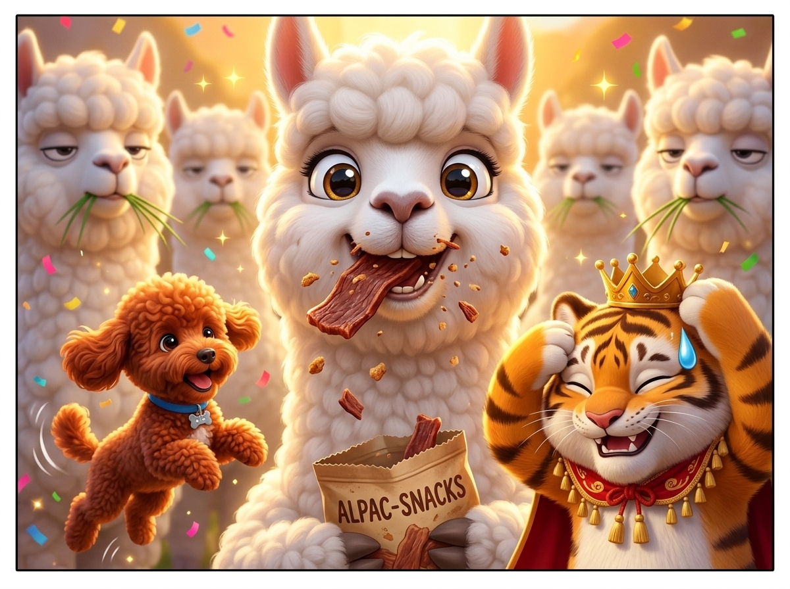

# 📖 第 02 話：《真假 Coco 羊駝大迷航》四格漫畫完整完稿

* **舞台**：秘魯・馬丘比丘（Machu Picchu）
* **主演**：Coco、小皮 (Pipi)、虎爺 (HoYa)、秘魯羊駝親友團

---

### 【第 1 格：起・榮歸故里】

> **Coco**：「咩～（驕傲挺胸：歡迎來到本駝的祖籍聖地！）」  
> **虎爺**：「靈氣逼人，勉強配得上本座巡視的排場！」  
> **小皮**：「汪嗚～！（興奮跳躍奔跑）」

---

### 【第 2 格：承・熱情親友團瞬間淹沒】

> **羊駝親友團**：「咩～～～！（海嘯般衝上前熱情貼貼）」  
> **虎爺**：「大膽！放肆！金冠都要被羊毛擠掉了啊啊！」  
> **小皮**：「嗷？（被毛球淹沒只露出一顆頭）」

---

### 【第 3 格：轉・靈魂拷問：哪隻才是 Coco？！】

> **虎爺**：「等一下！！你們怎麼全是複製貼上的？！到底哪一隻才是我們的 Coco 啊？！」  
> **5 隻羊駝**：「嚼嚼嚼……（集體佛系凝視嚼草）」  
> **小皮**：「……嗷？（歪頭徹底當機）」

---

### 【第 4 格：合・一秒破案的神反轉】

> **小皮**：「（掏出台灣肉乾）汪汪汪！（抓到了！是這隻！）」  
> **虎爺**：「破案了……會搶零食狂嚼的絕對是正牌沒錯……（擦冷汗）」  
> **滿嘴肉乾的 Coco**：「嚼嚼嚼嚼（幸福大眼睛：咩～！）」
